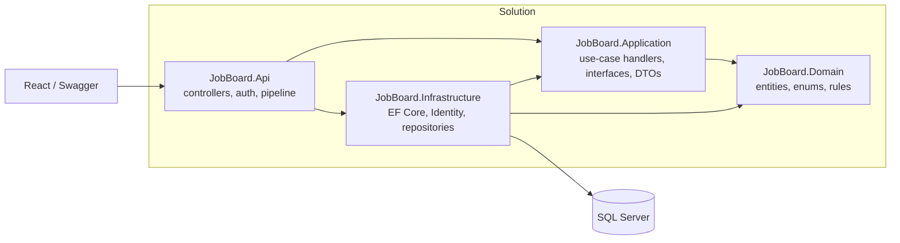

# JobBoard API

A job recruitment platform backend built with **ASP.NET Core Web API (.NET 10)** using **Clean Architecture**. Employers post and manage jobs and move applicants through a hiring pipeline; job seekers browse, apply, track their applications and maintain a profile.

**Live API (Azure App Service):** https://jobboard-api-epcce9g7dggmhvbn.uaenorth-01.azurewebsites.net
Swagger UI: [`/swagger`](https://jobboard-api-epcce9g7dggmhvbn.uaenorth-01.azurewebsites.net/swagger) · Public jobs: [`/api/Job`](https://jobboard-api-epcce9g7dggmhvbn.uaenorth-01.azurewebsites.net/api/Job) · Health: [`/health`](https://jobboard-api-epcce9g7dggmhvbn.uaenorth-01.azurewebsites.net/health)

> Hosted on a free tier: the first request after a quiet period can take several seconds while the app and database wake up.

## Tech stack

| Area | Technology |
| --- | --- |
| Framework | ASP.NET Core Web API, .NET 10, C# |
| Data | Entity Framework Core 10, SQL Server (Azure SQL in production, Docker/LocalDB locally) |
| Auth | ASP.NET Core Identity, JWT bearer tokens, role-based authorization |
| Docs | Swagger / OpenAPI |
| Tests | xUnit |
| Hosting | Azure App Service (F1) + Azure SQL Database |

## Architecture



Dependencies point inward: Domain depends on nothing, Application only on Domain, and frameworks (EF Core, Identity) live in Infrastructure. Each use case is its own handler (`CreateJobHandler`, `UpdateApplicationStatusHandler`, ...), and controllers stay thin: read the user from the token, call the handler, map the result to an HTTP response.

More detail is in [`docs/`](docs): architecture overview, domain model, requirements and a decision log.

## Features

**Authentication**
- Register as an Employer or Job Seeker, log in, receive a JWT (1 hour). `GET /api/Auth/me` returns the current user.
- Change your own password (current password required).
- Brute-force protection: login, register and change-password are rate limited per IP (10 requests/minute, then 429), and 5 wrong passwords lock the account for 15 minutes.
- Registration errors (duplicate email, weak password) come back as field-level validation errors.

**Employers**
- Create, edit and close their own jobs. Closing is a soft delete: the job disappears from browsing but its applications are kept.
- See all their jobs with applicant counts, filtered by `open`, `closed` or `all`.
- See applicants per job, open an applicant's full candidate profile and education, and move each application through the pipeline:
  `Applied → UnderReview → Shortlisted → Interview → Offered → Hired`, or `Rejected` from any open stage. Every change is recorded in a status history.

**Job seekers**
- Browse open jobs publicly, paged, with keyword search and filters for job type and location.
- Apply (once per job), see their applications and status, withdraw before the process ends.
- Maintain a candidate profile and education history.

## API overview

| Method | Route | Who | Purpose |
| --- | --- | --- | --- |
| POST | `/api/Auth/register` | anyone | Register (role: `Employer` / `JobSeeker`) |
| POST | `/api/Auth/login` | anyone | Log in, get a JWT |
| GET | `/api/Auth/me` | signed in | Current user from the token |
| POST | `/api/Auth/change-password` | signed in | Change my password |
| GET | `/api/Job?jobType=&location=&search=&page=&pageSize=` | anyone | Open jobs, paged (`{items,totalCount,page,pageSize}`), optional search and filters |
| GET | `/api/Job/{id}` | anyone | One open job |
| POST | `/api/Job` | Employer | Create a job |
| GET | `/api/Job/mine?status=open\|closed\|all` | Employer | My jobs (default `all`) |
| PUT | `/api/Job/{jobId}` | Employer (owner) | Edit an open job |
| POST | `/api/Job/{jobId}/close` | Employer (owner) | Close a job |
| GET | `/api/Job/{jobId}/applications` | Employer (owner) | Applicants for a job |
| POST | `/api/Job/{jobId}/applications` | Job Seeker | Apply |
| GET | `/api/Job/my-applications` | Job Seeker | My applications |
| PATCH | `/api/JobApplication/{id}/status` | Employer (owner) | Move an application forward / reject |
| PATCH | `/api/JobApplication/{id}/withdraw` | Job Seeker (owner) | Withdraw |
| GET | `/api/JobApplication/{id}/history` | Employer or Job Seeker (owner) | Status history |
| GET | `/api/JobApplication/{id}/candidate` | Employer (owner) | Applicant's candidate profile + education |
| GET / POST / PUT | `/api/CandidateProfile/me`, `/api/CandidateProfile` | Job Seeker | My profile |
| GET / POST / PUT / DELETE | `/api/CandidateEducation`, `/me`, `/{id}` | Job Seeker | My education records |

Ready-to-run requests for every flow are in [`JobBoard.Api/JobBoard.Api.http`](JobBoard.Api/JobBoard.Api.http).

## Design decisions worth noting

- **The user's identity only ever comes from the validated token.** No request body or URL contains an owner id, so a client can't act as someone else.
- **"Not yours" looks exactly like "doesn't exist" (404).** Ownership checks never reveal which ids exist or who owns them.
- **Race-safe writes.** Updates use a single `UPDATE ... WHERE` that re-checks owner and state, status changes use compare-and-swap inside a transaction together with their history row, and duplicate applications are blocked by a unique index (with a friendly 409 checked first).
- **Business rules in one place.** Allowed status transitions live in `Domain/Rules/ApplicationStatusRules.cs` and are unit-tested.
- **Production hardening.** Required configuration is validated at startup with a clear message, SQL connections retry transient failures (Azure SQL auto-pause), errors are returned as RFC 7807 ProblemDetails, and CORS origins come from configuration.

## Running locally

**Prerequisites:** .NET 10 SDK, and SQL Server (LocalDB on Windows, or Docker: `docker run -e ACCEPT_EULA=Y -e MSSQL_SA_PASSWORD=<password> -p 1433:1433 -d mcr.microsoft.com/mssql/server:2022-latest`).

1. Set secrets with User Secrets (never commit them):
   ```bash
   cd JobBoard.Api
   dotnet user-secrets set "ConnectionStrings:JobBoardDBConnection" "<your SQL Server connection string>"
   dotnet user-secrets set "Jwt:Issuer" "JobBoard"
   dotnet user-secrets set "Jwt:Audience" "JobBoardClient"
   dotnet user-secrets set "Jwt:SecretKey" "<Base64 key of at least 32 bytes>"
   ```
   Generate a key with `openssl rand -base64 32`, or in PowerShell:
   `[Convert]::ToBase64String([Security.Cryptography.RandomNumberGenerator]::GetBytes(32))`
2. Create the database:
   ```bash
   dotnet ef database update --project JobBoard.Infrastructure --startup-project JobBoard.Api
   ```
3. Run the API and open Swagger at `https://localhost:7036/swagger`:
   ```bash
   dotnet run --project JobBoard.Api
   ```
4. Run the tests:
   ```bash
   dotnet test
   ```

## Deployment (Azure)

- **Azure App Service** (Windows, .NET 10, F1) hosts the API; **Azure SQL Database** (free offer) holds the data. All migrations are applied to the Azure database.
- Configuration is set as App Service application settings, not files. A double underscore stands for `:` in nested keys:

  | Setting | Purpose |
  | --- | --- |
  | `ConnectionStrings__JobBoardDBConnection` | Azure SQL connection string |
  | `Jwt__Issuer`, `Jwt__Audience`, `Jwt__SecretKey` | Token settings |
  | `Cors__AllowedOrigins__0` | The deployed frontend's URL |
  | `EnableSwagger` | `true` to serve Swagger in production |

## Status and roadmap

- [x] Auth, jobs, applications with status workflow, candidate profile and education
- [x] Deployed to Azure
- [ ] React frontend
- [ ] Employer / company profile
- [ ] Docker image, CI/CD with GitHub Actions, Application Insights, Azure Key Vault
